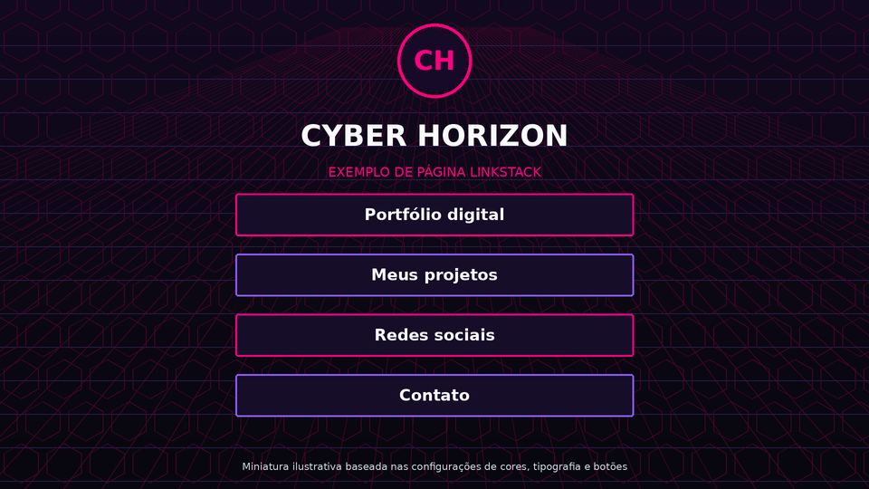
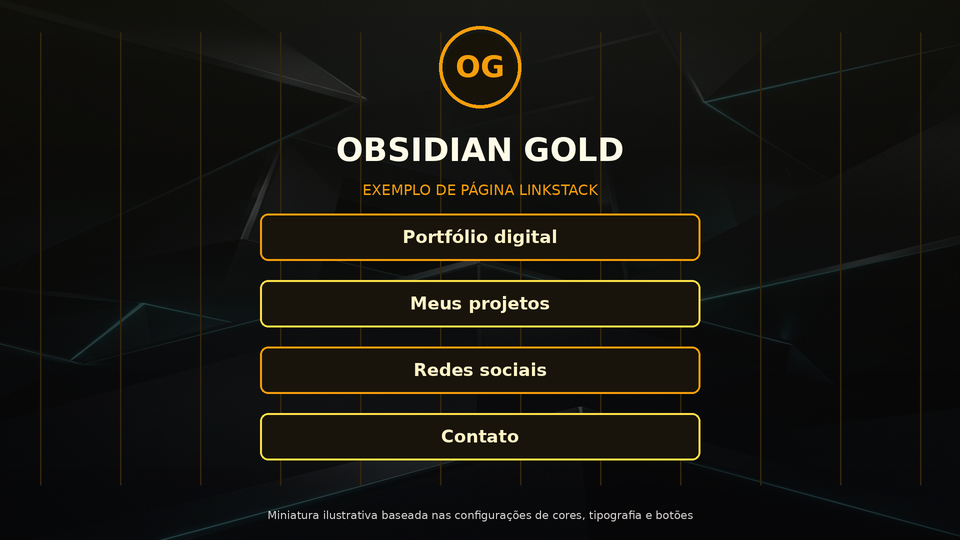
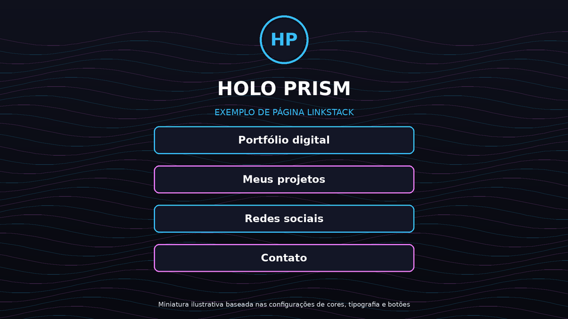
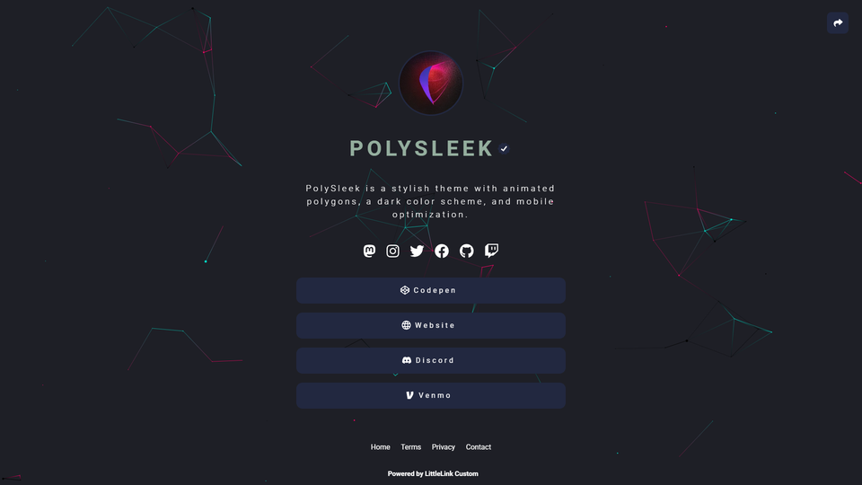
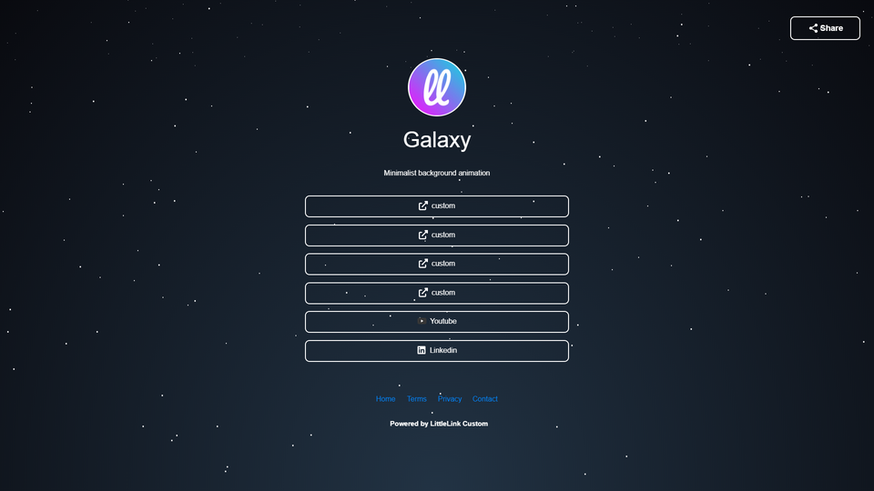

# Catálogo Free — temas LinkFree / LinkStack

Cada tema possui sua própria pasta com um arquivo ZIP **pronto para enviar ao importador do LinkStack**, uma imagem `thumbnail.png` de pré-visualização e instruções em `README.md`.

| Tema | Pré-visualização | Pacote para importar |
| --- | --- | --- |
| Cyber Horizon |  | [CyberHorizon.zip](CyberHorizon/CyberHorizon.zip) |
| Obsidian Gold |  | [ObsidianGold.zip](ObsidianGold/ObsidianGold.zip) |
| Holo Prism |  | [HoloPrism.zip](HoloPrism/HoloPrism.zip) |
| PolySleek |  | [PolySleek.zip](PolySleek/PolySleek.zip) |
| Galaxy |  | [galaxy.zip](galaxy/galaxy.zip) |

## Como instalar

1. Baixe **um ZIP individual** pelo link do tema desejado.
2. Entre no painel administrativo do LinkStack, vá em **Temas → Importar temas**, e faça o upload do ZIP.
3. Selecione o tema e confira a renderização da página pública.

**Não precisa descompactar nem incluir outra pasta `themes/` no ZIP.** Cada pacote já contém diretamente a pasta do próprio tema, como `CyberHorizon/config.php`.

As miniaturas dos temas futurísticos são **representações visuais baseadas nas configurações salvas**; não são capturas de um servidor Laravel em execução. Os ZIPs passam por validação automatizada de integridade e estrutura, mas recomenda-se testar a renderização e os efeitos em uma instalação LinkStack antes de publicar para usuários.

## Atualização

A automação [Publicar catálogo de temas LinkStack](../.github/workflows/publish-theme-catalog.yml) refaz os ZIPs e as thumbnails quando as configurações ou as referências dos temas são atualizadas. Os dois temas de referência mantêm os arquivos originais e suas licenças.